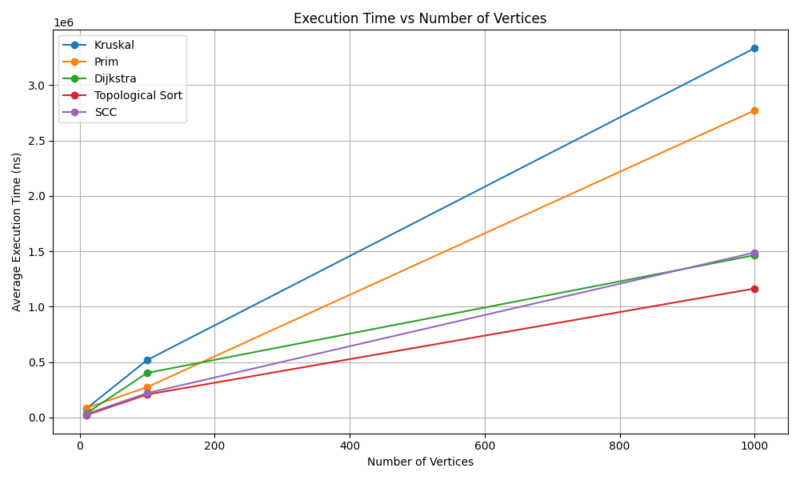
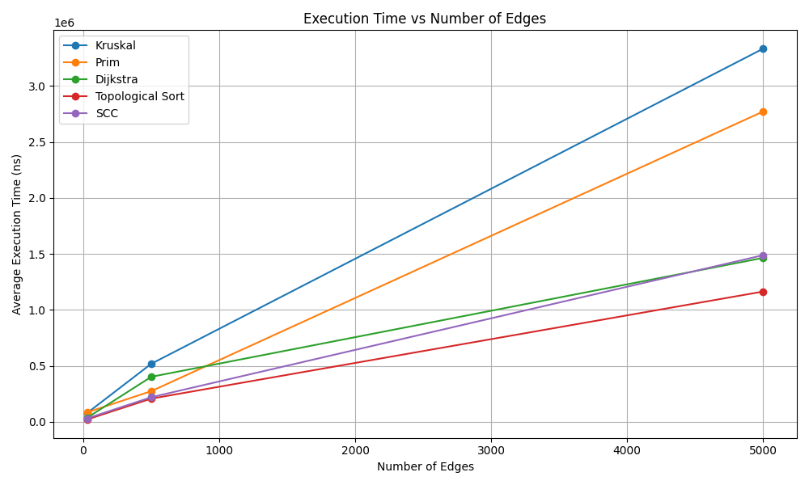

# Smart City Infrastructure and Route Planning

## 1. Project Overview

This project implements and analyzes graph algorithms used in Smart City Infrastructure and Route Planning.

The system models city districts as vertices and roads or connections as weighted edges. It implements algorithms for minimum spanning trees, connectivity analysis, topological sorting, strongly connected components, and shortest paths.

The main goal is to compare the performance and computational complexity of different graph algorithms.

## 2. Technologies Used

- Java
- IntelliJ IDEA
- Git and GitHub
- Python 3
- Matplotlib
- Java Collections Framework

## 3. Graph Representation

The project uses an adjacency list to represent graphs.

Each vertex represents a city district, and each edge represents a connection between districts.

Each edge contains:
- Destination vertex
- Edge weight

The graph supports both directed and undirected edges.

## 4. Implemented Algorithms

### 4.1 Disjoint Set Union (DSU)

DSU is used to efficiently manage connected components.

Implemented optimizations:
- Path compression
- Union by rank

These optimizations improve the efficiency of repeated union and find operations.

### 4.2 Kruskal's Algorithm

Kruskal's algorithm finds a Minimum Spanning Tree (MST).

Main steps:
1. Collect all unique edges.
2. Sort edges by weight.
3. Use DSU to check whether adding an edge creates a cycle.
4. Add valid edges to the MST.
5. Stop after selecting V - 1 edges.

### 4.3 Prim's Algorithm

Prim's algorithm also finds a Minimum Spanning Tree.

It uses:
- Adjacency lists
- A priority queue
- A visited array

The algorithm starts from vertex 0 and repeatedly selects the minimum-weight edge connecting the current tree to an unvisited vertex.

### 4.4 Topological Sorting

Topological sorting is implemented using Kahn's algorithm.

The algorithm:
1. Calculates the indegree of every vertex.
2. Adds vertices with zero indegree to a queue.
3. Processes vertices and updates the indegrees of adjacent vertices.
4. Detects cycles if not all vertices are processed.

### 4.5 Strongly Connected Components

Strongly Connected Components are found using Kosaraju's algorithm.

The algorithm performs two DFS passes:
1. DFS on the original graph to calculate finishing order.
2. DFS on the reversed graph in reverse finishing order.

### 4.6 Dijkstra's Algorithm

Dijkstra's algorithm calculates shortest paths from a source vertex.

It uses a priority queue to process vertices with the smallest known distance.

The implementation:
- Stores shortest distances.
- Stores previous vertices for path reconstruction.
- Detects negative edge weights.
- Handles unreachable vertices.
- Guards against integer overflow during distance addition.

Dijkstra's algorithm requires non-negative edge weights.

## 5. Time and Space Complexity Analysis

Let:
- V = number of vertices
- E = number of edges

| Algorithm | Time Complexity | Space Complexity |
|---|---|---|
| DSU operations | O(α(V)) amortized | O(V) |
| Kruskal | O(E log E) | O(V + E) |
| Prim (binary heap) | O((V + E) log V) | O(V + E) |
| Topological Sort | O(V + E) | O(V + E) |
| Kosaraju SCC | O(V + E) | O(V + E) |
| Dijkstra (binary heap) | O((V + E) log V) | O(V + E) |

Here, α(V) is the inverse Ackermann function, which grows extremely slowly.

## 6. Experimental Setup

Experiments were conducted using three graph configurations:

| Vertices | Edges |
|---:|---:|
| 10 | 30 |
| 100 | 500 |
| 1000 | 5000 |

Experimental settings:
- Fixed random seed: 12345
- Warm-up runs: 2
- Measurement runs: 5
- Execution time measured using System.nanoTime()
- Average execution time calculated over five runs
- Operation counts collected using OperationCounter

Undirected connected graphs were used for MST experiments.

Directed graphs were used for Dijkstra and SCC experiments. Directed acyclic graphs were used for topological sorting.

## 7. Benchmark Results

The following table contains the measured average execution times in nanoseconds and average logical operation counts.

| V | E | Kruskal ns | Kruskal ops | Prim ns | Prim ops |
|---:|---:|---:|---:|---:|---:|
| 10 | 30 | 80640 | 262 | 85600 | 133 |
| 100 | 500 | 518700 | 6405 | 274080 | 2255 |
| 1000 | 5000 | 3332320 | 87820 | 2771300 | 25219 |

| V | E | Dijkstra ns | Dijkstra ops | Topological ns | Topological ops | SCC ns | SCC ops |
|---:|---:|---:|---:|---:|---:|---:|---:|
| 10 | 30 | 38060 | 162 | 22140 | 101 | 31460 | 170 |
| 100 | 500 | 402300 | 2323 | 207320 | 1401 | 219980 | 2300 |
| 1000 | 5000 | 1464100 | 19791 | 1163520 | 14001 | 1488180 | 23000 |

The operation counts represent approximate logical operations tracked by the implementation. They are not CPU instruction counts.

Execution times are experimental measurements and may vary depending on hardware, JVM behavior, and system load.

## 8. Performance Graphs

### Execution Time vs Number of Vertices

### Execution Time vs Number of Edges

## 9. Testing

The project includes tests for important edge cases:

1. Single-vertex graph.
2. Disconnected graph.
3. Multiple possible Minimum Spanning Trees.
4. Cycle detection in topological sorting.
5. Strongly Connected Components.
6. Unreachable vertices in Dijkstra's algorithm.

All implemented tests passed during development.

## 10. Conclusion

The project demonstrates how graph algorithms can be applied to Smart City Infrastructure and Route Planning.

Kruskal's and Prim's algorithms successfully calculate Minimum Spanning Trees. Topological sorting detects cycles and provides valid vertex orders for directed acyclic graphs. Kosaraju's algorithm identifies strongly connected components, while Dijkstra's algorithm calculates shortest paths.

The experiments demonstrate how execution time and logical operation counts change as graph size increases.

The project also provides practical experience with graph representation, algorithm design, data structures, testing, benchmarking, and complexity analysis.
